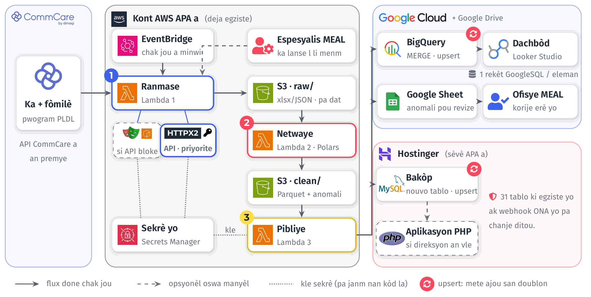
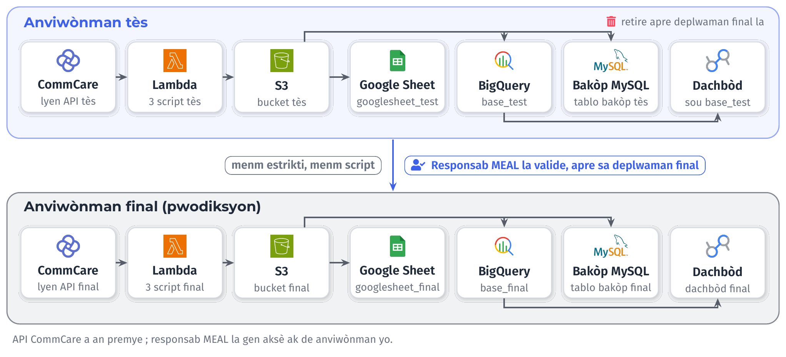
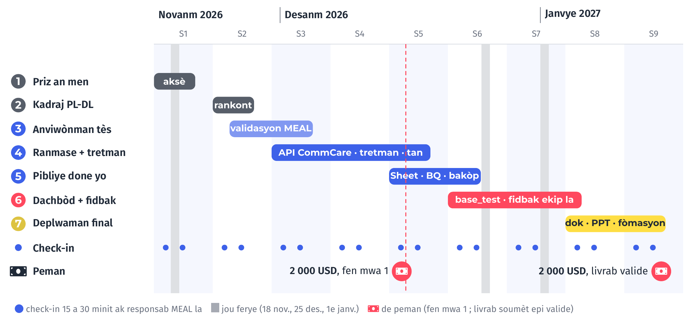

Dokiman sa a vini ak kontra konsiltasyon an. Kontra a di sa APA ap tann de mwen ; isit la, mwen
eksplike kijan m ap mete pwojè a an plas, etap pa etap, soti lendi 16 novanm 2026 rive vandredi
15 janvye 2027.

# Prensip yo

**API CommCare a an premye.** Script Ranmase a rele API CommCare a dirèkteman, ak yon kle API ki
sere nan sèvis sekrè AWS la, jamè nan kòd la. Li pran sèlman done ki chanje depi dènye fwa a, san
navigatè otomatik. Navigatè otomatik la (Playwright) rete yon solisyon sekou, sèlman si API a ta
bloke.

**Tout chanjman apwòch dokimante.** Si yon apwòch pa mache, m ap ekri sa ki pase, ki lòt chwa nou
genyen ak sa nou deside, epi m ap pataje l ak responsab MEAL la ak manm ekip APA yo anvan m chanje
anyen.

**Menm enfrastrikti a.** Sistèm nan sèvi ak kont AWS, Google Sheets, Looker Studio ak baz MySQL APA
genyen deja. Chak etap mete ajou sèlman sa ki chanje (*upsert*) : si yon script relanse, anyen pa
double.

{width=100%}

# Semèn 1 · Priz an men

Premye semèn nan se pou responsab MEAL la ak mwen. Nan fen semèn nan, men sa ki dwe fèt :

- Responsab MEAL la prezante m bay ekip la, epi li ban m aksè ak sistèm nan : CommCare, AWS,
  Google Cloud, Google Drive, baz MySQL la, ak dachbòd ki la deja.
- Nou fè seyans pou m konprann kisa Anseye Pou Ayiti ap fè ak kijan li swiv aktivite yo.
- Li prezante m fòmilè ONA yo ak fòmilè CommCare yo.
- Li di m ki pwoblèm li menm li genyen nan travay li. M ap fè lis yo, epi m ap di l nan ki nivo
  mwen ka ede l pandan kontra a.
- Li pataje kòd sous aplikasyon PHP APA a avè m. M ap kreye yon **òganizasyon GitHub APA**, gratis.
  APA se pwopriyetè òganizasyon an ; mwen se yon manm. Kòd la rete nan yon depo prive. Kle ak lòt
  sekrè yo pa janm antre nan depo a : yo rete nan fichye konfigirasyon ki pa sou GitHub. Nan fen
  kontra a, APA retire aksè mwen.

M ap dokimante tout sa nou wè pandan semèn nan.

# Kadraj ak ekip PL-DL la

Apre priz an men an, n ap fè yon rankont kadraj ak responsab MEAL la ak responsab ekip PL-DL la,
oswa yon manm ekip la. Objektif la se konprann :

- ki fòmilè CommCare ekip la itilize, ak kijan li fè swivi ak yo ;
- ki enfòmasyon ekip la vle jwenn nan dachbòd la (endikatè, filtè, nivo jewografik, peryòd) ;
- ki pwoblèm done yo genyen jodi a.

M ap ekri yon rapò rankont la epi voye l bay responsab MEAL la. Menm jan an, m ap dokimante sipò m
pote sou lòt pati sistèm monitoring APA a.

# Fason nou travay chak semèn

Mwen travay ak metòd ajil : ti etap, demonstrasyon souvan, ak koreksyon rapid. Chak semèn gen **de
rankont check-in** de 15 a 30 minit ak responsab MEAL la (pa egzanp madi ak jedi). Chak check-in
swiv menm plan an :

| Pati | Kesyon |
|:---------------------|:------------------------------------------------------------|
| **Avansman** | Kisa ki fini depi dènye check-in nan ? |
| **Difikilte** | Ki kote mwen bloke, epi poukisa ? |
| **Desizyon** | Ki apwòch nou chwazi ansanm ? |
| **Fòmasyon** | Ki pati sistèm nan responsab MEAL la aprann jodi a ? |

M ap ekri yon ti nòt pou chak check-in epi pataje l ak responsab MEAL la ak rès ekip la menm jou
a. Nòt sa yo ansanm vin yon jounal pwojè a.

# Anviwònman tès ak anviwònman final

Tout travay la fèt nan yon anviwònman tès ki gen menm estrikti ak sistèm final la. Konsa, deplwaman
final la pa pote okenn sipriz.

{width=100%}

| Eleman | Tès | Final |
|:----------------------|:-----------------------------|:-----------------------------|
| Lyen API CommCare | lyen tès pou chak fòmilè | lyen final (pwodiksyon) |
| Depo S3 | bucket tès | bucket final |
| AWS Lambda | 3 script tès | 3 script final |
| Google Drive | `googlesheet_test` | `googlesheet_final` |
| BigQuery | `base_test` | `base_final` |
| MySQL | tablo bakòp tès | tablo bakòp final |
| Dachbòd Looker Studio | sou `base_test` | sou `base_final` |

Responsab MEAL la gen aksè ak de anviwònman yo. Li valide anviwònman tès la anvan travay la
kòmanse ladan l. Lè deplwaman final la fini epi nou sèten tout bagay pase byen, n ap retire
anviwònman tès la.

# Etap travay yo, an detay

1. **Rale tout fòmilè yo.** Script Ranmase a rale tout fòmilè PL-DL yo pa API a, san erè, chak
   fwa li mache. Nou teste l sou plizyè jou anvan nou pase nan etap swivan an.
2. **Trete done yo.** Script Netwaye a retire doublon, tcheke valè ki manke ak dat ki pa kòrèk,
   epi make done ki gen pwoblèm.
3. **Evalye tan an.** Nou mezire konbyen tan rale ak tretman yo pran, pou nou asire yo rete nan yon
   tan akseptab pou APA.
4. **Google Sheet responsab MEAL la.** Done yo rive nan Google Drive li, an Google Sheet
   (`googlesheet_test`, apre sa `googlesheet_final`). Nan etap sa a, responsab MEAL la ka ban nou
   fidbak epi sèvi ak fichye a pou fè swivi ak ekip PL-DL la, pou ekip la bay reyaksyon l. Se done
   sa yo ki pral fè dachbòd la.
5. **BigQuery.** Done yo rive nan BigQuery (`base_test`, apre sa `base_final`).
6. **Tablo bakòp.** Done yo rive nan tablo bakòp MySQL la (tès, apre sa final). Tablo ki la deja
   yo ak aplikasyon PHP a pa chanje.
7. **GitHub.** Kòd sous la ak dokiman yo rete sou GitHub òganizasyon APA a pandan tout pwojè a.
8. **Dachbòd la.** Nou konstwi dachbòd Looker Studio a ak done `base_test` yo. Nou pataje lyen an,
   epi responsab MEAL la ede nou jwenn fidbak rès ekip la, pou nou konnen ki chanjman pou nou fè.
9. **Deplwaman definitif.** Nou deplwaye sistèm nan nan anviwònman final la. Mwen remèt dokiman
   yo, epi nou fè yon seyans ak responsab MEAL la pou m asire m li ka fòme rès ekip la.
10. **Retire anviwònman tès la**, lè nou sèten tout bagay pase byen nan deplwaman final la.
11. **Validasyon ak peman.** Premye peman an, 2 000 USD, fèt nan fen premye mwa a (15 desanm
    2026). Dezyèm peman an, 2 000 USD, fèt lè tout livrab yo fin soumèt epi valide. Mwen fè swivi
    administratif la epi soumèt dokiman ki ap fasilite chak peman.

# Kalandriye previzyonèl

{width=100%}

Reta yo trete jan kontra a di : yon reta ki depann de mwen pa koute APA anyen anplis ; yon reta ki
pa depann de mwen p ap retade peman yo ni validasyon livrab yo.

# Livrab yo

| Livrab | Kisa li ye |
|:--------------------------|:--------------------------------------------------------|
| **Dokiman sistèm nan** | Achitekti, kijan pou relanse yon etap alamen, kijan pou ajoute yon endikatè, kijan pou siveye sistèm nan |
| **PowerPoint sistèm nan** | Kijan sistèm nan mache, soti nan CommCare rive nan dachbòd la |
| **PowerPoint dachbòd la** | Kijan pou sèvi ak dachbòd la : paj yo, filtè yo, endikatè yo |
| **Kòd sous ak dokiman** | Sou GitHub òganizasyon APA a |
| **Sistèm ak dachbòd final** | An pwodiksyon, nan kont APA yo |
| **Nòt rankont yo** | Check-in yo, rankont kadraj la, sipò sou lòt pati sistèm monitoring APA a |
