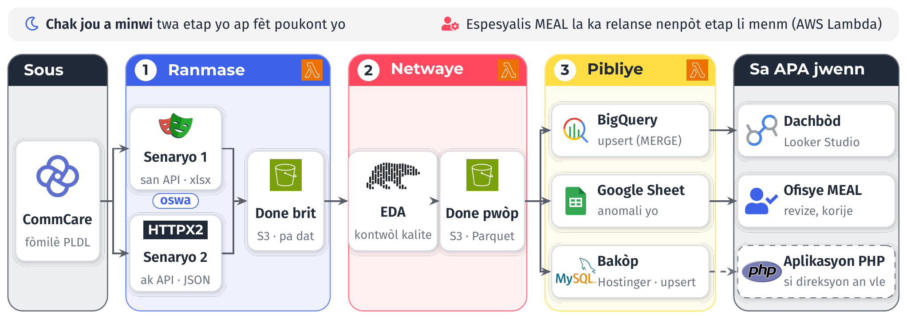
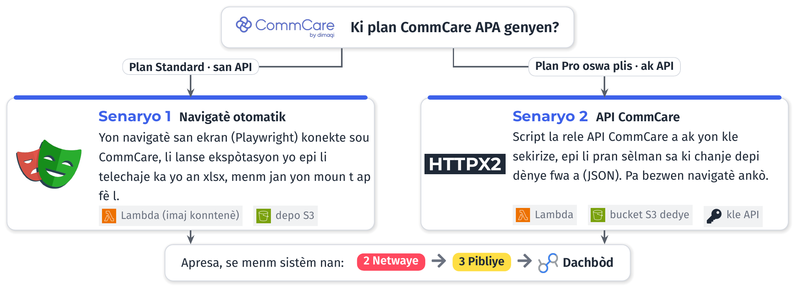

# Poukisa pwojè sa a

Yon pati nan done pwogram PLDL la ranmase sou CommCare. Jodi a, pou done sa yo rive nan yon rapò,
yon moun dwe ekspòte yo alamen, netwaye yo nan Excel, epi rekòmanse chak fwa gen nouvo fòmilè. Sa
pran tan, li ouvri pòt pou erè, epi done CommCare yo pa konekte ak sistèm APA genyen deja yo: baz
MySQL la sou Hostinger, script AWS yo, Google Sheets ak dachbòd Looker Studio yo.

Pwopozisyon sa a fè done PLDL yo vwayaje poukont yo, chak jou, soti nan CommCare rive nan yon
dachbòd, **san okenn nouvo sèvè**.

# Sa nou pwopoze

Sistèm nan gen twa etap. Chak etap se yon ti script Python sou AWS Lambda, nan menm kont AWS APA a
deja itilize pou script li yo. Chak jou a minwi twa etap yo ap fèt youn apre lòt. Espesyalis MEAL la ka relanse nenpòt nan yo lè li vle.

- **Ranmase.** Script la rale ka ak fòmilè PLDL yo nan CommCare epi li sere yo nan yon depo S3,
  pa dat.
- **Netwaye.** Yon dezyèm script fè analiz eksploratwa a (EDA): li retire doublon, li tcheke fòma
  ak valè ki pa koryan, epi li mete done pwòp yo apa.
- **Pibliye.** Twazyèm script la voye done pwòp yo nan BigQuery pou dachbòd la, li mete erè yo nan
  yon Google Sheet pou ofisye MEAL la, epi li fè yon bakòp nan yon nouvo tablo MySQL sou Hostinger.

Fason nou ranmase done yo depann de plan CommCare APA a. Plan Standard la pa bay aksè ak API a: lè
sa a, yon navigatè otomatik (Playwright) fè travay yon moun t ap fè alamen. Plan Pro a, oswa yon
plan ki pi wo, bay aksè ak API a: script la rele l dirèkteman ak yon kle sekirize (HTTPX2) epi li
pran sèlman sa ki chanje. Nan tou de ka yo, rès sistèm nan pa chanje ditou.

# Sa APA ap jwenn

- **Yon dachbòd Looker Studio** pou done PLDL yo, ak filtè pa dat, depatman, komin ak kowòt, yon
  kat, endikatè kle ak tandans. Chak grafik gen pwòp rekèt li, kidonk ajoute oswa korije yon
  endikatè fasil.
- **Yon Google Sheet pou ofisye MEAL la**, nan Google Drive li, ki montre chak jou done ki gen
  pwoblèm (doublon, valè ki manke, dat ki pa koryan) pou li korije yo nan sous la.
- **Yon bakòp nan baz MySQL APA a**, nan yon nouvo tablo apa. Tablo ki la deja yo ak aplikasyon PHP
  a pa chanje. Pita, si direksyon an vle, aplikasyon PHP a ka montre pwòp dachbòd li ak menm done
  sa yo.
- **Mizajou san doublon (*upsert*).** Olye nou efase epi rekopye tout done yo chak jou, chak script
  mete ajou sèlman sa ki chanje. Si yon script relanse de fwa, anyen pa double.
- **Dokimantasyon an kreyòl ak fòmasyon** pou espesyalis MEAL la, pou li ka relanse, siveye epi
  konprann chak etap.

# Pri enfrastrikti a

Nou reyitilise enfrastrikti APA genyen deja: kont AWS la, orè minwi a, Google Sheets, Looker Studio
ak baz MySQL la sou Hostinger. Sèvis nou ajoute yo rete nan kota gratis yo, paske volim done PLDL
yo piti: AWS Lambda bay 1 milyon apèl ak 400 000 GB-segonn gratis chak mwa, BigQuery bay 10 GiB
depo ak 1 TiB rekèt gratis chak mwa.

# Dire

Misyon ap dire **3 mwa**. 3 mwa sa yo ap pèmèt:

- Nou byen devlope pwojè an
- Nou byen komprann done PLDL yo
- Nou byen teste pwojè an
- Asire solidite sistèm nou mete an plas lan
- Pou sèten nou rete nan limit kote nou pa ogmante depans sèvis niyaj AWS, Hostinger e GCP, APA yo.
- Byen dokumante pwojè an e fè fòmasyon pou spesyalis MEAL lan.

# Konsiltan an

Alexandro Disla se enjenyè done ak espesyalis MEAL, ak plis pase dis ane eksperyans ant
administrasyon piblik ayisyen an, pwogram bayè entènasyonal yo ak devlopman lojisyèl. Li te mete
fòmilè CommCare an plas sou plizyè sit pou yon pwogram sante Caris Foundation, li bati pipeline done
ki mennen nan BigQuery ak dachbòd Looker Studio nan Tekkod, epi li travay chak jou ak Python, AWS
Lambda, S3, Playwright, Polars, MySQL ak PHP. Li pale, li ekri epi li dokimante an kreyòl.

# Prèv travay

Mwen deja konstwi kalite dachbòd sa a. Men de paj nan yon rapò Looker Studio mwen fè kòm enjenyè done
nan Tekkod, pou Steam The Streets.

**Kontak:** Alexandro Disla · alexandrodisla@hotmail.com · (+509) 4148-3700 · github.com/AD0791
