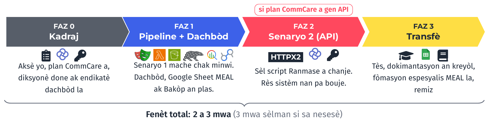
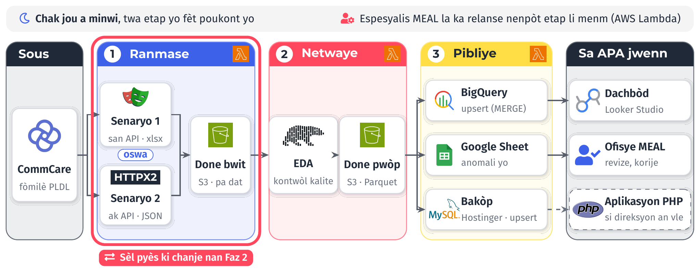
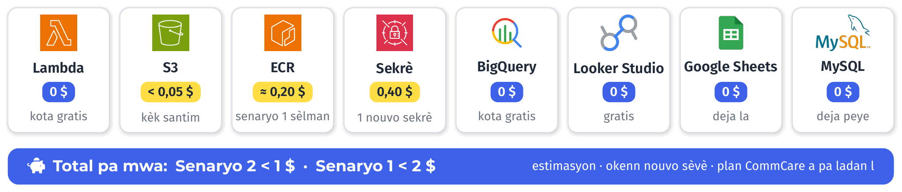
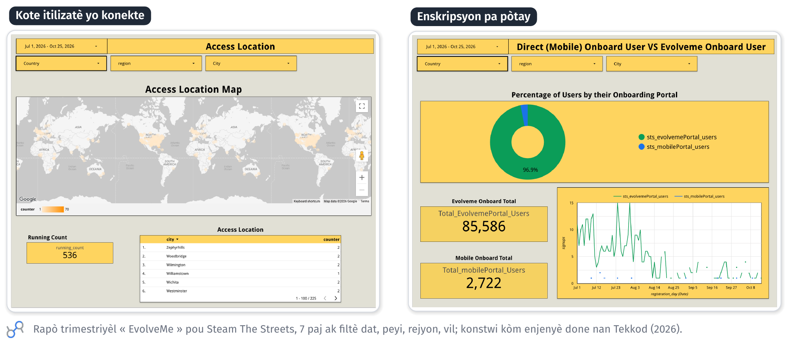

# Objektif

Yon pati nan pwogram PLDL la ranmase sou CommCare. Pwopozisyon sa a mennen done sa yo, chak jou e
otomatikman, jiska yon dachbòd Looker Studio, an kat faz. Chak faz fini ak livrab APA ka wè epi
teste. Nou reitilize enfrastrikti APA genyen deja (AWS, Google Sheets, Looker Studio, MySQL sou
Hostinger), epi nou bati tout bagay ak *upsert*: yon etap ka relanse san li pa kreye doublon.

# Wout la

# Sistèm nan an yon sèl foto

Twa script Python sou AWS Lambda fè travay la chak jou a minwi: Ranmase, Netwaye, Pibliye. Si plan
CommCare APA a pa gen API (plan Standard), Ranmase sèvi ak yon navigatè otomatik (Playwright). Si
plan an gen API (Pro oswa plis), Ranmase rele API a dirèkteman (HTTPX2). Se sèl pyès sa a ki chanje
ant de senaryo yo.

# Faz yo ak livrab yo

## Faz 0 · Kadraj

- **Livrab:** aksè yo ak dwa minimòm (CommCare, AWS, GCP, MySQL); konfimasyon plan CommCare a;
  diksyonè done PLDL (fòmilè, chan, kowòt); lis endikatè dachbòd la, fèt ansanm ak ekip MEAL la.
- **Akseptasyon:** direksyon an ak espesyalis MEAL la valide lis endikatè yo.

## Faz 1 · Pipeline ak dachbòd

- **Livrab:** twa Lambda yo nan kont AWS APA a, chak jou a minwi (Senaryo 1); depo S3 bwit ak pwòp;
  tablo BigQuery ak `MERGE`; Google Sheet anomali pou ofisye MEAL la; nouvo tablo bakòp MySQL;
  dachbòd Looker Studio v1.
- **Akseptasyon:** sèt jou youn dèyè lòt san entèvansyon; total dachbòd la koresponn ak CommCare;
  relanse yon script pa kreye okenn doublon.

## Faz 2 · Senaryo 2, si plan an gen API

- **Livrab:** Ranmase vèsyon HTTPX2 (Case API v2, kle API sekirize, sèlman sa ki chanje); Playwright
  retire.
- **Akseptasyon:** sou menm peryòd la, Senaryo 2 bay menm done ak Senaryo 1; Netwaye ak Pibliye pa
  chanje.
- Si plan an rete Standard, Faz 2 vin yon gid pou chanjman an pita, epi tan sa a ale nan amelyorasyon
  dachbòd la.

## Faz 3 · Tès, dokimantasyon ak transfè

- **Livrab:** tès otomatik sou règ kalite yo; dokimantasyon an kreyòl (achitekti, relans manyèl,
  kijan pou ajoute yon endikatè); fòmasyon espesyalis MEAL la; kòd la remèt nan depo Git APA a.
- **Akseptasyon:** espesyalis MEAL la relanse yon etap epi li ajoute yon endikatè poukont li.

# Pri ak enfrastrikti

Pa gen okenn nouvo sèvè. Nou itilize kont AWS la, orè minwi a, Google Sheets, Looker Studio ak baz
MySQL APA genyen deja, epi sèvis nou ajoute yo rete nan kota gratis yo paske volim done PLDL yo piti.

# Prèv travay

Mwen deja konstwi kalite dachbòd sa a. Men de paj nan yon rapò Looker Studio mwen fè kòm enjenyè done
nan Tekkod, pou Steam The Streets.

**Kontak:** Alexandro Disla · alexandrodisla@hotmail.com · (+509) 4148-3700 · github.com/AD0791
