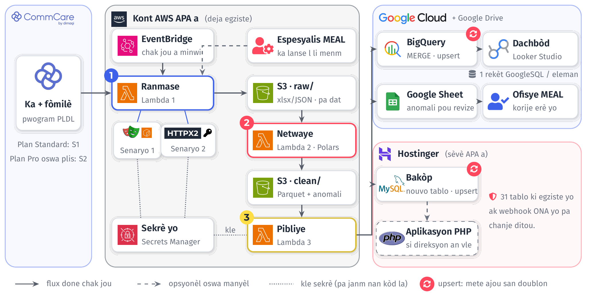
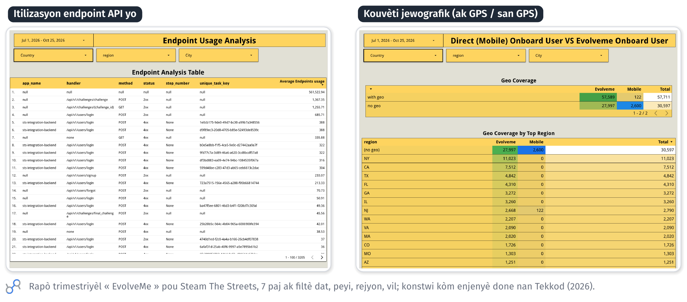

# Kontèks ak objektif

Yon pati nan pwogram PLDL la ranmase sou CommCare. Objektif la se rale done sa yo otomatikman chak
jou, fè analiz eksploratwa (EDA) sou yo, epi bati yon dachbòd Looker Studio, pandan nou reyitilise sa
APA genyen deja: kont AWS la (Lambda, S3, Secrets Manager, orè minwi a), Google Sheets, Looker Studio
ak baz MySQL la sou Hostinger. Tout sistèm nan bati ak *upsert* nan tèt li: nenpòt etap ka relanse
san li pa kreye doublon.

# Achitekti

Orè minwi a (EventBridge) lanse Lambda 1. Chak fwa yon fichye rive nan S3, evènman S3 a lanse etap
ki vin apre a, kidonk pa gen okenn sèvè ki toujou limen. Espesyalis MEAL la ka relanse chak Lambda
separeman nan konsòl AWS la. Modil Ranmase a gen de vèsyon ki ka ranplase youn lòt san rès sistèm
nan pa bouje:

- **Senaryo 1, plan san API.** Playwright, nan yon imaj konntenè Lambda (Chromium san ekran),
  konekte ak yon kont CommCare dedye, li lanse ekspòtasyon yo, li tann yo prepare, epi li telechaje
  fichye xlsx yo.
- **Senaryo 2, plan Pro oswa plis.** HTTPX2 rele Case API v2 CommCare a (`/api/case/v2/`) ak yon
  kle API (antèt `ApiKey`). Li swiv lyen `next` la paj an paj, jiska 5 000 ka pa paj, epi filtè
  `server_last_modified` la pran sèlman sa ki chanje depi dènye siksè a. Kle API a pa mande kòd 2FA,
  epi li ka limite pa adrès IP.

# Twa script yo

| Script | Deklanchè | Sòti | Zouti |
|:---------|:----------------|:----------------------|:--------------------|
| 1 Ranmase | Orè minwi oswa manyèl | S3 `raw/`, pa fòmilè ak pa dat | Playwright (S1) oswa HTTPX2 (S2) |
| 2 Netwaye | Nouvo fichye nan `raw/` | S3 `clean/` (Parquet), `anomali/` | Polars |
| 3 Pibliye | Nouvo fichye nan `clean/` | BigQuery, Google Sheet, MySQL | google-cloud-bigquery, gspread, PyMySQL |

# Upsert ak idanpotans

| Depo | Kle | Kijan |
|:----------|:----------|:------------------------------------------|
| S3 | fòmilè + dat | Menm kle a ranplase fichye jou a: relanse bay menm rezilta a. |
| BigQuery | `case_id` | Chaje nan yon tablo tanporè (chajman gratis), epi `MERGE` nan tablo final la. |
| MySQL | `case_id` (kle inik) | `INSERT … ON DUPLICATE KEY UPDATE`, menm modèl ak resepsyon fòmilè swivi yo nan baz la jodi a. |
| Google Sheet | `case_id` + règ | Onglè anomali yo rekalkile chak jou. |

# Kontwòl kalite (EDA)

Script Netwaye a tcheke doublon (menm ka, menm moun), chan obligatwa ki vid, dat ki pa koryan (nan
lavni oswa anvan pwogram nan kòmanse), valè andeyò lis (depatman, komin, kowòt), kowòdone GPS ki
manke oswa ki tonbe andeyò Ayiti, ak swivi ki pa gen anrejistreman. Chak anomali vin yon liy nan
Google Sheet la (ka, chan, valè, règ, dat). Ofisye MEAL la korije l nan CommCare, epi koreksyon an
antre nan sistèm nan nan pwochen minwi a.

# Sekirite

- Tout kle (CommCare, GCP, MySQL) rete nan AWS Secrets Manager, jamè nan kòd la ni nan Google Sheet la.
- Yon itilizatè MySQL dedye ki gen dwa sèlman sou nouvo tablo a, atravè menm koneksyon sekirize
  script AWS yo deja itilize.
- Yon kont sèvis GCP ak dwa minimòm: BigQuery sou dataset la sèlman, ak Sheet la pataje avè l.
- Yon kont CommCare dedye pou otomatizasyon; kle API a limite pa adrès IP lè sa posib.

# Sa APA ap jwenn

- **Twa Lambda Python yo, deplwaye nan kont AWS APA a**, ak orè minwi a ak relans manyèl pa
  espesyalis MEAL la. Tout kòd la rete nan depo Git APA a.
- **Yon dachbòd Looker Studio** pou done PLDL yo. Chak eleman (kat, endikatè, grafik, tablo) gen
  pwòp rekèt GoogleSQL li nan BigQuery: chak chif fasil pou verifye, epi kach Looker Studio a kenbe
  rekèt yo nan kota gratis la. Paj yo: apèsi (endikatè kle), jewografi (kat, depatman, komin),
  kowòt ak tandans, kalite done (ak GPS, san GPS, anomali).
- **Yon Google Sheet pou ofisye MEAL la**, nan Google Drive li: onglè anomali yo rekalkile chak jou
  pou li korije erè yo nan CommCare.
- **Yon bakòp nan baz MySQL APA a**: nouvo tablo `commcare_pldl` ak kle inik `case_id`. Tablo ki la
  deja yo ak aplikasyon PHP a pa chanje; pita, si direksyon an vle, aplikasyon PHP a ka montre pwòp
  dachbòd li ak menm done sa yo.
- **Mizajou san doublon (*upsert*)** sou chak depo, jan seksyon 4 la dekri l.
- **Dokimantasyon an kreyòl ak fòmasyon** pou espesyalis MEAL la: achitekti, relans manyèl, kijan
  pou ajoute yon endikatè.

# Risk ak solisyon

| Risk | Solisyon |
|:-----------------|:------------------------------------|
| CommCare chanje paj li yo (S1) | Sèlektè Playwright yo santralize nan yon sèl fichye, ak alèt imel si ekspòtasyon an echwe. S2 elimine risk sa a. |
| 2FA sou kont CommCare a (S1) | Kont dedye ak sekrè TOTP nan Secrets Manager. S2 pa mande 2FA. |
| Ekspòtasyon long, limit 15 minit Lambda | Ekspòtasyon pa fòmilè ak pa peryòd. S2 pran sèlman sa ki chanje. |
| Yon script echwe nan mitan lannwit | Jounal CloudWatch, alèt, relans manyèl. *Upsert* la anpeche doublon. |

# Pri ak dire

Misyon ap dire **3 mwa**. 3 mwa sa yo ap pèmèt:

- Nou byen devlope pwojè an
- Nou byen komprann done PLDL yo
- Nou byen teste pwojè an
- Asire solidite sistèm nou mete an plas lan
- Pou sèten nou rete nan limit kote nou pa ogmante depans sèvis niyaj AWS, Hostinger e GCP, APA yo.
- Byen dokumante pwojè an e fè fòmasyon pou spesyalis MEAL lan.

# Prèv travay

Detay teknik dachbòd la se yon bagay mwen deja fè: men de paj nan yon rapò Looker Studio mwen konstwi
kòm enjenyè done nan Tekkod, pou Steam The Streets.

**Kontak:** Alexandro Disla · alexandrodisla@hotmail.com · (+509) 4148-3700 · github.com/AD0791
